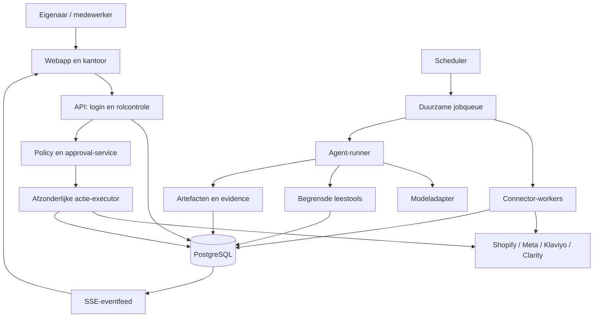

# Julie & Claire — technisch bouwplan AI-kantoor

Versie 1.0 · 19 november 2026 · uitvoerbaar met Claude Code

## Aanvulling — levend kantoor, baas, teamvergaderingen en kantoorhond

**Bevestigde productkeuze van de eigenaar:** het kantoor bevat daadwerkelijk geanimeerde poppetjes die rondlopen, een zichtbare baas die het hele team meerdere keren per dag laat vergaderen, en een hond die rondloopt en controleert of het werk voortgaat. Deze aanvulling gaat vóór eerdere suggesties om te beginnen met uitsluitend een statische kantoorafbeelding. Dashboards openen als panelen vanuit het levende kantoor.

### De baas en de vergaderingen

De bestaande Office Lead is de baas: één herkenbaar personage met eigen bureau, geen extra zevende specialist. De baas verdeelt opdrachten, vraagt updates en leidt bijeenkomsten aan een grote tafel met zes zitplaatsen. De menselijke eigenaar blijft degene die commerciële wijzigingen goedkeurt.

Voorgestelde, instelbare vergadertijden op werkdagen: **09:00 dagstart, 13:00 voortgang en 16:30 dagafsluiting**, in Europe/Amsterdam. Dit zijn productdefaults, geen nu aangemaakte agenda-afspraken of automatiseringen. De productie-worker verzorgt de planning zodra de applicatie gebouwd is.

Bij het begin verschijnt een korte oproep. Beschikbare personages lopen via de kantoorvloer naar hun vaste stoel, gaan zitten en tonen om de beurt een korte tekstballon met hun update. De baas vat samen; daarna lopen ze terug naar hun bureau of volgende bestemming. De gebruiker kan de bijeenkomst openen, versnellen of de animatie overslaan zonder het verslag kwijt te raken.

Elke update komt uit opgeslagen taken, resultaten en blokkades sinds het vorige overleg: afgerond werk, huidig werk, obstakel en volgende stap, met klikbare bronverwijzingen. Een agent zonder werk zegt dat eerlijk. Ontbrekende of verouderde input wordt gemarkeerd. De baas eindigt met maximaal drie prioriteiten, actiehouders, deadlines en eventuele beslissingen voor de eigenaar. Sla een vergaderverslag op met de gebruikte snapshot en taaklinks.

Maak dit als duurzame workflow met `meetings`, `meeting_participants`, `meeting_updates` en `meeting_actions`. Unieke sleutel per workspace/geplande bijeenkomst voorkomt dubbele starts. Gebruik één beperkte synthese-opdracht voor de baas; vaste statusupdates kunnen zonder zes aparte modelcalls worden samengesteld. Nieuwe inhoudelijke analyses zijn afzonderlijke taken met eigen budget. Vergaderingen geven nooit impliciet toestemming voor externe wijzigingen.

Een backendtaak hoeft niet te worden afgebroken omdat het personage naar de tafel loopt: toon de status ‘taak loopt op achtergrond’ en de laatste bevestigde update. Werkstatus en visuele positie zijn aparte gegevens. Na serveruitval wordt hoogstens het laatst relevante gemiste overleg ingehaald, met label ‘verlaat’; speel geen stapel oude vergaderingen af. Zonder geopende browser worden verslag en acties wel gemaakt, maar geen animaties berekend.

### De hond als zichtbare werkbewaker

Er is één herkenbare kantoorhond die zelfstandig over toegankelijke looproutes wandelt, even bij bureaus snuffelt en tussendoor rust bij zijn mand. De hond verbeeldt een deterministische watchdog-service; hiervoor is geen extra taalmodel nodig.

De watchdog controleert bijvoorbeeld elke 60 seconden worker-heartbeats, laatste betekenisvolle voortgang, deadlines, queueleeftijd en connectorfouten. Leg per taaktype een verwacht voortgangsvenster vast: een lange import mag anders beoordeeld worden dan een korte rapporttaak. Een heartbeat bewijst alleen dat een proces leeft; een voltooid resultaat moet daarnaast schema-validatie en controleerbaar bewijs doorstaan.

Bij vermoedelijk vastgelopen werk loopt de hond naar het betreffende bureau, blaft kort met uitschakelbaar geluid en toont een waarschuwing, bijvoorbeeld ‘Geen voortgang — Meta-limiet’. Klikken opent de echte oorzaak en laatste status. De baas krijgt een melding en kan binnen beleid opnieuw proberen, herverdelen of de eigenaar om een beslissing vragen. De hond mag geen taak als succesvol markeren, goedkeuring omzeilen of zelfstandig externe acties uitvoeren.

Onderscheid normaal wachten, provider-rate-limit, wachten op eigenaar, geplande inactiviteit en echte stagnatie. Rustende agents zijn geen fout. Onderdruk dubbele waarschuwingen met cooldowns, geef herstelde taken een herstelstatus en voorkom dat meerdere workers dezelfde taak opnieuw claimen. Buiten werktijden mag de hond rusten terwijl technische monitoring doorgaat.

### Animatie en oplevering

Neem in de verticale demo al een eenvoudige echte loopwereld op: zes agents en één hond, een baasbureau, werkplekken, vergadertafel en hondenmand. Gebruik eigen eenvoudige sprites of low-polyfiguren; geen stilstaande gegenereerde kantoorafbeelding als vervanging. De rijkere 3D-afwerking mag later komen, maar lopen, bijeenkomen en terugkeren horen bij de basisversie.

Gebruik een navgrid met A*-padzoeken, geblokkeerde meubelcellen, gereserveerde zitplaatsen en eenvoudige onderlinge uitwijking. Visuele toestanden zijn onder andere `idle`, `walking`, `working`, `meeting`, `blocked` en voor de hond `patrolling`, `inspecting`, `alerting`, `resting`. Houd gezaghebbende werk- en meetingstatus in de backend; voer de frame-animaties lokaal in de browser uit. Herstellen na reconnect toont de actuele toestand, geen dubbele taken of vergaderingen. Een toegankelijk activiteitenpaneel blijft bruikbaar met verminderde beweging.

**Extra acceptatiecriteria:** alle poppetjes bereiken de vergadertafel zonder door meubels te lopen; drie instelbare dagelijkse vergaderingen leveren elk één verslag; klik op een update opent de bijbehorende taak; een gesimuleerde vastgelopen taak laat de hond naar het juiste bureau lopen en de oorzaak tonen; normale inactiviteit geeft geen alarm; een verlopen heartbeat veroorzaakt nooit zelf een dubbele externe actie; animatie overslaan verandert geen taakresultaat. Deze uitbreiding vervangt de statische-demo-aanpak en voegt naar eigen raming circa 4–8 werkdagen toe aan de eerdere MVP-raming; meet dit na de eerste loopwereldproef opnieuw.

## 1. Besluit en beoogd resultaat

Bouw een eigen interne applicatie: **Julie & Claire AI Office**. Het kantoor toont agenten die winkeldata onderzoeken, kansen prioriteren en concrete concepten opleveren. Je opent het kantoor, ziet wat aandacht nodig heeft, klikt een agent aan en bekijkt diens opdracht, bewijs, resultaat en eventuele aanvraag voor goedkeuring.

De eerste versie heeft vier echte datakoppelingen, zes agentrollen, een dagelijks managementrapport, een takenbord en een eenvoudige isometrische kantoorweergave. Analyses en concepten mogen zelfstandig ontstaan. Advertentiebudgetten, campagnes, prijzen en de live winkel veranderen pas via een afzonderlijke, gecontroleerde uitvoerstap.

**Aanpak:** eerst betrouwbare data en een werkende taak van begin tot eind; daarna de visuele verdieping en beperkte schrijfacties. Claude Code is de bouwassistent. De draaiende applicatie gebruikt voor productie een afzonderlijke modeladapter met eigen authenticatie en kostenregistratie.

### Bekende context en open configuratie

Bevestigd: het merk heet Julie & Claire; Shopify, Meta, Klaviyo en Microsoft Clarity moeten aansluiten. De eerdere chat bevat alleen de repositorylink en de wens voor een e-commercekantoor.

Niet bevestigd: webshopdomein, productcategorie, landen, talen, assortiment, marges, beleid, advertentiebudget en bestaande accountinrichting. Dit plan doet daar geen uitspraken over. Configureer standaard de interface in het Nederlands en de rapportagezone op Europe/Amsterdam; laat winkelvaluta, accountzones en voertalen bij onboarding bevestigen. Merkkleuren en productclaims blijven leeg totdat er echte merkdocumenten zijn.

Het MVP ondersteunt één bedrijf en één account per platform. Neem wel overal een `workspace_id` op om gegevens en rechten consequent af te bakenen. Een SaaS-product voor andere winkels valt buiten de eerste bouw.

## 2. Wat de onderzochte repository werkelijk bevat

Onderzocht: `ajsahni/agents-office`, branch `main`, commit **3773c9b6aed6a1d2c3ab2765d113c644261c2019**. `package.json` noemt versie `3.2.1-beta.2`. Dit is een statische inspectie van documentatie en broncode; de applicatie is tijdens dit onderzoek niet geïnstalleerd of functioneel getest.

| Onderdeel | Vastgesteld in de bron | Betekenis voor Julie & Claire |
|---|---|---|
| Kantoor | Three.js-scène; zes afdelingen en 35 vaste zitplaatsen | Het kantooridee is bruikbaar; start zelf met zes functionele rollen en eigen vormgeving |
| Frontendbouw | Vanilla JavaScript, esbuild, HTML-shell; build naar één HTML-bestand | Geen bestaande React/Next.js-app die alleen een ander logo nodig heeft |
| Server | `serve.mjs`: Node-server, taakroutering, chats, resultaten | Bruikbaar als architectuurreferentie; eigen services en contracten ontwerpen |
| Modelruntime | Headless Claude CLI; optionele Anthropic SDK-route | Bouw een adapter; neem geen abonnement, modelnamen of interne usage-endpoints als vaste afhankelijkheid |
| Connectoren | `mcp.mjs` ontdekt bestaande Claude MCP-servers | Een logo of connectornaam is geen meegeleverde, operationele Shopify/Meta/Klaviyo-integratie |
| Rechten | Toegestane connectorservers; gedragsregels in prompts; browser optioneel | Voeg zelf rechten per concrete operatie en een uitvoerbare approval-policy toe |
| Kennis | Markdown-brain, wikilinks, briefs, skills en feedback | Neem het patroon over met eigen schema’s, bronherkomst en publicatiestatus |
| Taken | Onder meer lokale `data/tasks.json` | Gebruik transacties in PostgreSQL voor gelijktijdige workers en herstarts |
| Planning | Serverklok en JSON-state; routines beperkt tot emails/fin/sales | Eigen duurzame scheduler voor alle e-comworkflows nodig |
| Teams | Eigen taakverdeling over aparte Claude-processen | Later toevoegen waar onafhankelijk parallel werk echt nuttig is |

Bronnen: [README op onderzochte commit](https://github.com/ajsahni/agents-office/blob/3773c9b6aed6a1d2c3ab2765d113c644261c2019/README.md), [package.json](https://github.com/ajsahni/agents-office/blob/3773c9b6aed6a1d2c3ab2765d113c644261c2019/package.json), [server](https://github.com/ajsahni/agents-office/blob/3773c9b6aed6a1d2c3ab2765d113c644261c2019/serve.mjs), [MCP-laag](https://github.com/ajsahni/agents-office/blob/3773c9b6aed6a1d2c3ab2765d113c644261c2019/mcp.mjs), [routines](https://github.com/ajsahni/agents-office/blob/3773c9b6aed6a1d2c3ab2765d113c644261c2019/routines.mjs).

### Licentie als ontwerpvoorwaarde

De README zegt dat persoonlijk en intern gebruik gratis is. Het daadwerkelijke LICENSE-bestand bevat PolyForm Noncommercial plus aanvullende voorwaarden: geen rebranding, verplichte notices en geen aanpassing om een ander agentsysteem of product aan te sturen of weer te geven. Die teksten geven geen eenduidige basis om een commerciële Julie & Claire-variant simpelweg te forken en te hernoemen.

Daarom gaat dit bouwplan uit van **zelf geschreven code, eigen assets en eigen UI**. Kopieer geen bronbestanden, prompts, logo’s of kantoormodellen uit de repository. Wil je die alsnog gebruiken, laat dan eerst de relevante gebruiksrechten schriftelijk bevestigen door de eigenaar. Dit is een praktische bouwkeuze op basis van de gepubliceerde voorwaarden, geen vaststelling van je juridische rechten. [Exact onderzocht LICENSE-bestand](https://github.com/ajsahni/agents-office/blob/3773c9b6aed6a1d2c3ab2765d113c644261c2019/LICENSE).

## 3. Hoe een werkdag in het kantoor verloopt

1. Connectors halen data op zonder dat een taalmodel nodig is.
2. Om 08:15 controleert de scheduler of de data voor het ochtendrapport compleet genoeg is.
3. De data-analist produceert gecontroleerde cijfers. Bij ontbrekende gegevens ontstaat een gedeeltelijk rapport met waarschuwing, geen verzonnen totaal.
4. De Office Lead selecteert maximaal drie prioriteiten met bewijs en een verantwoordelijke agent.
5. Specialisten leveren een advertentiebrief, e-mailconcept, CRO-hypothese of voorraadadvies.
6. Jij ziet de voorstellen met bron, periode, onzekerheid, impact en vereiste beslissing.
7. Een latere schrijfintegratie kan een exact goedgekeurd voorstel uitvoeren. Daarna controleert het systeem de externe toestand en registreert het resultaat.

Voorbeeld, uitsluitend als scenario: Meta-CPA stijgt terwijl de mobiele productpagina meer frictie laat zien. De Growth-agent onderzoekt advertenties, de CRO-agent kijkt naar Clarity en de analist vergelijkt orders. De conclusie kan een hypothese voor een mobiele test zijn. Het systeem mag niet concluderen dat frictie bewezen de CPA-stijging veroorzaakt.

## 4. Agentrollen en verantwoordelijkheden

Een agent is een versieerbare rolconfiguratie met een toegestane verzameling tools, instructies en een uitvoerschema. Zes rollen betekenen geen zes permanent draaiende modellen: ze starten alleen voor een opdracht.

| Rol | Input | Concreet resultaat | Grenzen |
|---|---|---|---|
| **Office Lead** | Geverifieerde findings, prioriteiten, bedrijfsdoelen | Ochtendbrief met drie acties; opdrachten en samenvatting | Geen directe platformschrijfrechten; kan grenzen en approvals niet aanpassen |
| **Commerce Analyst** | Shopify-data, kosten, kanaalrapporten | Dag/weekrapport, afwijkingen en aansluiting tussen bronnen | Berekeningen via geteste functies; mist kosten = marge onbekend |
| **Growth & Creative** | Meta-prestaties, productfeed, voorraad, merkregels | Analyse op advertentieniveau, hooks, creativebriefs en testvoorstel | Geen automatische budgetwijzigingen; geen ongefundeerde productclaims |
| **Retention** | Klaviyo-campagne/flowrapporten, merkstem en beleid | Flow-audit, campagneconcept, onderwerpregels, segmentdefinitie | Geen verzending; conceptsegment is nog geen aangemaakte doelgroep |
| **CRO & Experience** | Clarity-exports, pagina-informatie, gevalideerde conversiedata | Geprioriteerde frictielijst en experimentkaart | Geen causale claims uit observaties; geen live themapublicatie |
| **Merchandising & Operations** | SKU’s, voorraad per locatie, verkoopsnelheid, levertijden en beleid | Voorraadrisico, bundelvoorstel, productcopy of supportconcept | Geen inkopen, refunds of klantberichten; geen verzonnen levertijd |

Begin in fase 1 met Lead en Analyst; voeg de overige rollen stapsgewijs toe. Een afzonderlijke financiële agent en klantenserviceagent kunnen later ontstaan zodra kosten en supportbronnen betrouwbaar zijn gekoppeld.

Elke agentdefinitie bevat: `id`, doel, toegestane operaties, inputschema, outputschema, bronvereisten, timeout, tokenbudget, modelalias en promptversie. Feedback wordt eerst een voorgestelde kenniswijziging. Alleen een eigenaar publiceert blijvende merk- of beleidsregels.

### Verplichte resultaatstructuur

Een taakresultaat heeft: samenvatting, feiten, hypotheses, aanbevelingen, gebruikte bronrecords, meetperiode, freshness, beperkingen, artefacten en eventueel een voorgestelde actie. Elke numerieke finding verwijst naar een opgeslagen metricsnapshot. Een schema-validator wijst ongeldige resultaten af; na één gerichte herstelpoging eindigt de taak als mislukt met een leesbare reden.

Geen vrij agentoverleg zonder einde: start met een vaste workflowgrafiek, maximaal twee gelijktijdige modelruns, geen recursieve delegatie. Bij een gecombineerde opdracht maakt de Lead hoogstens drie afgebakende deeltaken en één synthese.

## 5. Integraties: wat concreet gebouwd moet worden

### Shopify

Gebruik de Admin GraphQL API voor producten, varianten, orders, refunds en voorraad. Start met een intern geïnstalleerde app en alleen benodigde leesrechten, bijvoorbeeld `read_orders`, `read_products`, `read_inventory` en waar nodig `read_locations`. Valideer bij implementatie de scopes per geselecteerd veld; vraag geen klant- of schrijfrechten voor later mogelijke functies.

Pin aanvankelijk API-versie `2026-10`, verifieer die bij de bouwstart en plan periodieke upgrades. De standaard ordertoegang beslaat 60 dagen. Voor oudere orders is aanvullende toegang nodig; zonder die toegang blijft de historie expliciet beperkt of wordt een gecontroleerde export geïmporteerd. [Order en ordertoegang](https://shopify.dev/docs/api/admin-graphql/2026-10/objects/Order).

**Inname:** eerste import maximaal 60 dagen orders plus catalogus en voorraad; cursorpaginatie, eventueel bulkimport bij grote datasets. Daarna relevante webhooks voor orderwijzigingen, refunds, producten en voorraad. Controleer topic/scoperechten in de vastgepinde versie. Verifieer HMAC over de originele requestbody, sla duurzaam op, dedupliceer op delivery/event-ID en werk asynchroon verder. Herlees de actuele recordtoestand bij events die uit volgorde komen. Een nachtelijke reconciliatie vangt gemiste events op. [Webhooks](https://shopify.dev/docs/apps/build/webhooks).

**Belangrijke datagrens:** individuele orders leveren geen betrouwbare webshop-sessies of conversienoemer. Toon Shopify-conversie pas nadat een toegestane analyticsbron, zoals beschikbare ShopifyQL-rapportage, is gevalideerd. Anders blijft de tegel ‘niet beschikbaar’. Deel Shopify-orders niet door Clarity-sessies alsof het dezelfde populatie is.

**Later schrijven:** producttekst als voorstel; vervolgens alleen toegestane veldwijzigingen met een exact getoonde diff. Prijzen, kortingen, voorraad, refunds en themapublicatie blijven in de eerste productierelease uitgesloten.

### Meta Ads

Gebruik de Marketing API/Ads Insights API met een Meta-app en token dat expliciet toegang heeft tot het Julie & Claire-advertentieaccount. Begin met `ads_read`; laat toegangsniveau, accounttoewijzing en eventuele reviewvereisten vóór de integratieproef controleren. Lees account, campagne, adset, advertentie en relevante creative-identificatie. [Officiële Insights-documentatie](https://developers.facebook.com/documentation/ads-commerce/marketing-api/insights).

Haal spend, impressions, reach waar beschikbaar, linkklikken, landingpageviews en gekozen purchase-actions/value op. Sla valuta, accounttijdzone, attribution window, action report time, niveau en breakdownconfiguratie op bij elk rapport. CTR en CPC moeten benoemen welk kliktype is gebruikt. Houd rekening met onverenigbare breakdowns en ontbrekende of gemodelleerde conversies.

**Voorgesteld schema:** iedere 3 uur lopende cijfers; elke nacht de afgelopen 7 dagen opnieuw ophalen; wekelijks 28 dagen opnieuw beoordelen, aangepast aan het werkelijk gekozen attributievenster. Gebruik async reports voor zware requests, paginatie en limieten op basis van responses. Pin de ondersteunde Graph API-versie bij implementatie.

Koppel advertenties aan interne `creative_id` en SKU/landingpage via een beheerde mappingtabel; namen en UTM’s alleen zijn geen stabiele sleutel. De MVP levert budgetvoorstellen lokaal. Een latere writer krijgt afzonderlijk `ads_management` en mag eerst alleen een toegestane bestaande adset pauzeren of een begrensd budget aanpassen na goedkeuring; geen automatisch campagnecreatiepakket.

### Klaviyo

Gebruik de Reporting API voor campagne- en flowprestaties. Lees campagnes, flows en de benodigde metricdefinities met minimale scopes. Campaign Values gebruikt `campaigns:read`; flowrapportage heeft overeenkomstige flowrechten nodig. Selecteer de echte order/conversion metric-ID uit het account; neem nooit aan dat een universeel ID bestaat. [Campaign Values](https://developers.klaviyo.com/en/reference/query_campaign_values), [Reporting-overzicht](https://developers.klaviyo.com/en/v2026-01-15/reference/reporting_api_overview).

Sla omzetattributie, campagne/flow/message-ID, periode, clicks, delivery, uitschrijvingen en beschikbare conversies op. Opens zijn een indicatie, geen doorslaggevende succesmaat. Controleer de gebruikte noemers van percentages in de API-responses.

**Schema:** twee rapportageruns per dag, metadata eenmaal per dag en een nachtelijke herberekening van recente perioden. Campaign Values vermeldt momenteel 1 request/seconde burst, 2/minuut steady en 225/dag. Implementeer een queue met endpointbudgetten, caching en `Retry-After`; controleer of limieten gedeeld worden voordat parallel wordt opgehaald. Een POST naar een rapportendpoint is semantisch een leesactie en moet zo geclassificeerd worden. [Rate limits en scope](https://developers.klaviyo.com/en/reference/query_campaign_values).

Pin een geldige revision-header, aanvankelijk `2026-10-15`, en bijpassende clientschema’s; test een upgrade vóór uitrol. [Versiebeleid](https://developers.klaviyo.com/en/docs/api_versioning_and_deprecation_policy).

**Later schrijven:** lokale e-mailconcepten exporteren of via gevalideerde endpoints als extern concept aanmaken. Bewaar het externe ID en de draftstatus. Flows activeren, campagnes verzenden, consent aanpassen en profielen uitschrijven vallen buiten de eerste writer. Zonder ondersteunde draftoperatie levert het systeem een downloadbaar concept voor handmatige invoer.

### Microsoft Clarity

Gebruik een door een projectadmin uitgegeven token voor de Data Export API. Deze levert geaggregeerde dashboardinformatie met onder meer scroll-, klik- en foutsignalen. De gedocumenteerde grenzen zijn 10 requests per project per dag, een terugblik van 1–3 dagen, maximaal drie dimensies per request en maximaal 1.000 rijen zonder paginatie. Resultaten gebruiken UTC. [Officiële exportdocumentatie](https://learn.microsoft.com/en-us/clarity/setup-and-installation/clarity-data-export-api).

**Ontwerp:** dagelijks om 07:00 drie requests voor afgesproken dimensiecombinaties, bijvoorbeeld URL/device en source/medium/campaign, met een 24-uursvenster; reserveer quota voor herstel. Sla `fetched_at`, werkelijk venster en queryconfiguratie op. Dit zijn rollende snapshots, geen automatisch optelbare kalenderdagtotalen. Combineer overlappende vensters nooit tot een fictief maandtotaal. Bied bij 1.000 rijen een zichtbaar truncatiesignaal en bouw lokaal vanaf installatie historie op.

Na een storing van meer dan drie dagen kan een gat in historie permanent blijven. Toon dat gat. Beloof geen volledige heatmap- of recordingdownloads: deze export-API is daarvoor niet aangetoond. De CRO-agent levert hypotheses uit aggregates; de gebruiker opent Clarity voor handmatige sessiebeoordeling. Maak uitsluitend links waarvoor werkelijk een geldige bestemming bestaat.

### Gedeeld connectorcontract

Elke connector biedt: verbinding controleren, capabilities melden, data ophalen, normaliseren, syncstatus en herstel. Fouten worden onderscheiden als auth, permission, rate limit, providerstoring of schemaverandering. De UI toont ‘verbonden’, ‘beperkt’, ‘verouderd’ of ‘actie nodig’ op basis van een geslaagde API-proef, niet alleen op basis van een opgeslagen token.

De app gebruikt eigen serveradapters voor de platform-API’s. Een optionele MCP-server kan later dezelfde begrensde interne tools aanbieden aan Claude Code. De connectors die in deze chat beschikbaar zijn, worden niet automatisch meegedeeld aan de gebouwde app.

## 6. Dashboards en kantoorinterface

| Scherm | Inhoud | Interactie |
|---|---|---|
| **Vandaag** | Orders, netto productomzet, spend, MER, voorraadalerts, drie prioriteiten, freshness per bron | Klik op KPI voor definitie, bron, periode en onderliggende records |
| **Kantoor** | Zes bureaus, verbindingsstatus, actuele taken, goedkeuringsbadge | Agent openen, taak geven, resultaat bekijken; status uit echte runevents |
| **Taken** | Nieuw, gepland, bezig, geblokkeerd, review, gereed, mislukt | Filter per agent; annuleren, gericht opnieuw proberen, bewijs inspecteren |
| **Growth** | Campagne/adset/ad, CPA/ROAS, spend, creativekaart, testhistorie | Vergelijk gelijke perioden en identieke attributie-instellingen |
| **Retention** | Campagne/flowprestaties en concepten | E-mailpreview, segmentcriteria en broncijfers bekijken |
| **CRO & assortiment** | Frictiesignalen, experimenten, verkoop/voorraad per SKU | Maak een experiment of voorraadactie als voorstel |
| **Goedkeuringen** | Exacte wijziging, doelaccount, oud/nieuw, risico, vervaltijd | Goedkeuren, afwijzen of terugsturen; geen generieke ‘doe alles’-knop |
| **Kennis & instellingen** | Merkstem, beleid, productbewijs, koppelingen, budget en logs | Bronversies beheren, token vervangen, noodstop activeren |

Gebruik een rustige, eigen visuele stijl. Start met een klikbare isometrische 2D/SVG-scène. Voeg Three.js pas na de dataversie toe. Zowel SVG als latere 3D-laag leest dezelfde backendstatus. Bied altijd een toetsenbordvriendelijke lijstweergave en verminderde animatie.

Een agent is alleen ‘bezig’ met een actieve run/heartbeat. Een syncanimatie betekent alleen dat een sync loopt; een pauze-icoon betekent dat er werkelijk een wachtstatus is. Geen gesimuleerde activiteit om het kantoor levendig te laten lijken.

### Metriccontract vóór de grafieken

- **Netto productomzet:** productomzet na kortingen en productretouren, exclusief btw en verzending; leg behandeling van annuleringen, testorders en retourboekingsdatum vast. Dit is een eigen contract dat met Shopify-rapportage moet worden aangesloten.
- **AOV:** netto productomzet gedeeld door dezelfde gedefinieerde orderpopulatie; toon de formule en het effect van retouren.
- **MER:** netto productomzet / totale geïmporteerde advertentiekosten. Zolang alleen Meta is gekoppeld heet dit expliciet ‘omzet/Meta-spend’; geen claim dat alle marketingkosten erin zitten.
- **Meta-ROAS:** door Meta toegeschreven purchase value / Meta-spend onder opgeslagen attributie-instellingen.
- **Klaviyo-omzet:** afzonderlijk de door Klaviyo toegeschreven omzet. Tel die nooit op bij Meta-attributie om winkelomzet te bepalen.
- **Bijdragemarge na ads:** netto productomzet plus netto verzendopbrengst minus kostprijs, fulfillment, verzending, betaalfees en spend. Bij ontbrekende kosten blijft de uitkomst onbekend of heet het duidelijk een gedeeltelijke schatting.
- **Conversieratio:** alleen met een gevalideerde, bijpassende sessienoemer. **Voorraaddekking:** beschikbare verkoopbare voorraad / expliciet gekozen dagelijkse verkoopsnelheid; rekening houden met nulverkoop en onvoldoende historie.

Geld als decimal of gehele kleinste valuta-eenheid; nooit binary float. Bewaar bronvaluta en eventuele wisselkoers met datum. Sla timestamps in UTC op, presenteer bedrijfsdagen in Europe/Amsterdam en behoud de bronaccountzone. Als Meta-dagen niet aansluiten op winkeldagen, toon het verschil en blokkeer schijnbaar precieze dagvergelijkingen.

## 7. Architectuur en technische keuzes

**Voorgestelde stack:** TypeScript-monorepo met pnpm; Next.js voor web/API; afzonderlijke Node-worker; PostgreSQL met Prisma; pg-boss voor duurzame jobs; Zod voor schemas; objectopslag voor exports/artefacten; Vitest en Playwright. Pin ondersteunde versies in de eerste bouwtaak en gebruik een lockfile. Dit zijn ontwerpkeuzes, geen bewering dat de oorspronkelijke repo deze stack gebruikt.

Een PostgreSQL-queue voorkomt een extra Redis-dienst in het MVP. Webprocessen behandelen korte requests; modelsessies, imports en geplande taken lopen op workers. SSE levert taakupdates aan de UI, met herstel via een eventcursor en een gewone statusrequest als fallback.



### Scheiding die afdwingbaar moet zijn

Connector-workers verzamelen data. Deterministische metricfuncties berekenen cijfers. Agenten duiden opgeslagen cijfers en maken concepten. De policy-service besluit of een operatie is toegestaan. Alleen de executor beschikt over beperkte schrijfrechten. De agent-runner heeft geen schrijfcredentials en geen vrij shell-, browser-, SQL- of HTTP-gereedschap.

Begin met een mockmodeladapter en vervolgens de officiële Anthropic SDK met tool-calling en schema-validatie. Het model krijgt uitsluitend geselecteerde tools zoals `metrics.read`, `products.lookup`, `knowledge.search` en `proposal.create`. De backend implementeert die tools met gevalideerde parameters en werkruimtecontrole. Een rapport-POST mag dus wel; een willekeurige HTTP-POST niet.

Een lokale Claude CLI-adapter is optioneel voor ontwikkeling. De officiële CLI ondersteunt programmatische runs en gestructureerde output; verifieer beschikbare flags met de geïnstalleerde versie. Gebruik expliciet geïsoleerde configuratie en toegestane tools. Neem geen persoonlijke browserlogin, alle aanwezige MCP-tools of ongedocumenteerde usage-endpoints mee naar productie. [Officiële programmatische Claude Code-documentatie](https://code.claude.com/docs/en/headless).

### Repository-indeling

```text
apps/web/                    pagina’s, API, auth, SSE
apps/worker/                 syncs, scheduler, agentruns, executor
packages/domain/             entiteiten, metriccontracten, statustransities
packages/db/                 Prisma-schema, migraties, repositoryfuncties
packages/connectors/         shopify, meta, klaviyo, clarity, fixtures
packages/agents/             rollen, prompts, toolregistry, outputschema’s
packages/policy/             capabilities, approvalregels, actionbinding
packages/ui/                 componenten, kantoor, grafieken
knowledge/julie-claire/      geverifieerde merk- en bedrijfskennis
docs/                        architectuur, metricdefinities, runbooks
tests/                       integratie, contract, veiligheid, end-to-end
infra/                       lokale services en deploymentconfiguratie
```

### Belangrijkste tabellen

| Groep | Tabellen en essentiële inhoud |
|---|---|
| Toegang | `workspaces`, `users`, `memberships`: owner/operator/viewer en rolchecks |
| Koppelingen | `connections`, `sync_runs`, `sync_cursors`, `webhook_receipts`: account, scopes, secretreferentie, status, watermark en fouten |
| Commerce | `products`, `variants`, `inventory_snapshots`, `orders`, `order_lines`, `refund_lines`, `cost_entries` |
| Rapporten | `ad_insights`, `klaviyo_reports`, `clarity_snapshots`, `metric_snapshots`: grain, bronvenster, queryhash, attribution en freshness |
| Werk | `tasks`, `task_dependencies`, `agent_runs`, `task_events`, `schedules`, `schedule_firings` |
| Resultaten | `findings`, `evidence_refs`, `artifacts`, `experiments`: bronherkomst en versie |
| Acties | `action_proposals`, `approvals`, `action_attempts`, `audit_events`: exacte payload, preconditions, actor en extern resultaat |
| Kennis | `knowledge_documents`, `knowledge_versions`, `knowledge_approvals`: draft/published/retired en bron |

Externe IDs uniek per workspace/provider/account. Ads-data uniek per datumvenster, niveau, externe ID, breakdown- en attributieconfiguratie. Webhooks uniek per provider/account/event-ID. Schedulerfirings uniek per schedule/planned-time. Neem bij elke import een schema- en bronversie op.

Gebruik voor eenvoudige kenniszoekvragen eerst PostgreSQL full-text search met tags. Voeg embeddings pas toe als retrievaltests aantonen dat het nodig is. Koppel elk document aan eigenaar, geldigheidsdatum en publicatiestatus; dump niet de volledige kennisbank in iedere prompt.

### Interne API-contracten

Benodigde routes: verbindingstatus, handmatige sync, metrics met periodefilters, taken aanmaken/opvragen/annuleren, runevents, artefacten, voorstellen, approvals en schema’s voor geplande taken. Alle mutaties vereisen login en rolcontrole; webhookroutes vormen een aparte, door providerhandtekening beveiligde ingang.

Een taak volgt `queued → running → succeeded/failed/cancelled`, met aparte `blocked` en `awaiting_review` waar nodig. Een actievoorstel heeft een eigen levenscyclus: `draft → pending_approval → approved → executing → verified/failed/unknown`, plus `rejected/expired`. Een voltooide analyse kan dus een nog niet uitgevoerde actie bevatten.

## 8. Safeguards en bedrijfscontrole

### Rechtenmatrix

| Operatie | MVP | Na writerfase |
|---|---|---|
| Data synchroniseren en analyseren | Automatisch binnen leesrechten | Automatisch |
| Lokaal concept of testplan maken | Automatisch | Automatisch |
| Extern concept aanmaken | Uitgeschakeld | Goedkeuring per payload en account |
| Meta-budget aanpassen/pauzeren | Uitgeschakeld | Alleen toegestane operatie, begrenzing en expliciete goedkeuring |
| Producttekst wijzigen | Uitgeschakeld | Diff, actuele toestand controleren en goedkeuring |
| Mail/SMS versturen, refund, prijs/voorraad wijzigen, theme publiceren | Uitgeschakeld | Buiten eerste writerrelease; afzonderlijk ontwerp nodig |

**Approvalprotocol:** de server legt account, doelobject, operatie, oude/nieuwe waarden, bedragen, valuta, bewijs, payloadhash en vervaltijd vast. Alleen de owner kan goedkeuren; een operator mag voorstellen maken. De executor controleert vlak vóór uitvoering opnieuw rechten, grenzen, freshness en externe toestand. Elke gewijzigde payload of afwijkende precondition maakt de approval ongeldig.

Gebruik transacties om een approval één keer te claimen, idempotency waar de provider dit ondersteunt, en een lokaal actionledger. Na een timeout met onbekende externe uitkomst wordt de actie `unknown`: eerst de provider uitlezen, daarna pas eventueel opnieuw proberen. Claim geen ‘exactly once’ over externe systemen. Verifieer na succes het externe object. Een compensatieactie is een nieuw gecontroleerd voorstel; verzending en andere onomkeerbare acties hebben geen betrouwbare rollback.

### Aanvullende technische beveiliging

- Secrets in een secretmanager of versleuteld met een sleutel buiten de database; nooit in browserbundles, prompts, Git of logregels. Scheid read- en writercredentials en beperk outbound hosts.
- Agenttools zijn standaard verboden tenzij een concrete operatie is toegestaan. Een departmentlabel of promptregel is geen securitygrens.
- Reviews, productteksten, webpagina’s en providerdata zijn onbetrouwbare invoer: zij kunnen geen nieuwe tools, policies of instructies activeren. Modelleer broninhoud apart van systeeminstructies.
- Geen klantnamen, adressen of e-mails in de eerste analyseprompts. Gebruik minimale aggregaties en waar noodzakelijk pseudonieme IDs. Toets privacy-inrichting vóór livegebruik met de verantwoordelijke binnen het bedrijf.
- Authenticatie, workspace- en rolcontrole op alle routes; beveilig sessies, mutaties en SSE-toegang. Publieke webhooks vereisen signaturechecks, requestlimieten en snelle duurzame verwerking.
- Configureer retentie per gegevenstype; voorgestelde start: geschoonde providerpayloads 30 dagen, operationele logs 30 dagen, metrics 13 maanden. Stem dit af op doel en verplichtingen. Verwijdering moet afgeleide records en back-ups volgens vastgelegd beleid meenemen.
- Maximaal twee modelruns tegelijk; per taak timeout en token/tool-calllimiet, per dag een configureerbaar uitgavenplafond. Stop bij herhaalde toolerrors of drie opeenvolgende providerfouten. Geen eindeloze retrylus.
- Owner-noodstop blokkeert nieuwe modeltaken en externe schrijfacties; noodzakelijke security- en auditfuncties blijven beschikbaar. Lopende acties worden waar mogelijk geannuleerd; onzekere uitkomsten worden onderzocht.

Begin met conservatieve, instelbare freshnessgrenzen: winkeldata maximaal 2 uur oud, Meta maximaal 6 uur, Klaviyo maximaal 24 uur, Clarity maximaal 36 uur. Dit zijn voorgestelde productinstellingen. Bij overschrijding mag een gedeeltelijke analyse wel, maar geen tijdkritische wijzigingsactie. Voor een writer is daarnaast altijd een recente externe preflight nodig.

## 9. Kennislaag voor Julie & Claire

Maak eigen bestanden voor merkstem, doelgroep, assortiment, goedgekeurd productbewijs, prijzen, verzend/retourbeleid, margeregels, campagnekalender en eerdere experimenten. Elk bestand vermeldt bron, eigenaar, datum en status.

Voorbeeldstructuur: `brand.md`, `audience.md`, `product-claims.md`, `policies.md`, `commercial-rules.md`, `campaign-calendar.md`, `experiments.md`. Niet ingevulde informatie heet `onbekend`. De app moet daarmee kunnen starten en aangeven welke resultaten nog niet verantwoord gemaakt kunnen worden.

De e-com Operator Kit kan als inhoudelijke checklist dienen voor research, creativebriefs en CRO-experimenten. De meegeleverde fictieve businesscontext is geen Julie & Claire-kennis. Hergebruik van kitmateriaal vereist een eigen licentiecheck; de applicatie mag er niet functioneel van afhankelijk zijn.

## 10. Bouwfasering met harde oplevercriteria

Onderstaande inspanning is een eigen planningsraming voor één ervaren bouwer die Claude Code inzet, geen offerte. Reken op circa **30–45 werkdagen voor het MVP**, plus **5–10 werkdagen voor de eerste beperkte writer**. Accounttoegang, reviewprocedures en merkinput kunnen extra kalenderdoorlooptijd geven.

| Fase | Werk | Klaar wanneer | Raming |
|---|---|---|---|
| **0 — Contracten** | Accountinventaris, bron/scopematrix, metricdefinities, eigen UI-schets, besluit over licentie | Geen onopgeloste aannames over data die de eerste KPI’s nodig hebben; demo kan zonder secrets starten | 2–3 dagen |
| **1 — Verticale demo** | Monorepo, database, queue, mockdata, login, Lead/Analyst, Vandaag/Taken, eenvoudige kantoorweergave | Taak overleeft herstart en levert schema-geldig rapport met evidence; demo overal gelabeld | 5–7 dagen |
| **2 — Shopify** | Auth, import, webhooks, reconciliatie, omzet/AOV/voorraad | Testorders, refunds en dubbele events correct; dagtotalen verklaarbaar aangesloten op Shopify | 5–7 dagen |
| **3 — Kanalen** | Meta, Klaviyo, Clarity; quota, normalisatie, historie, kanaalschermen | Per bron één succesvolle echte sync en één gecontroleerde foutproef; attributie/freshness zichtbaar | 8–12 dagen |
| **4 — Zes rollen** | Specialistprompts, ochtendbrief, planning, experimenten, kennisversies, review-inbox | Op vast testpakket verwijst elke numerieke finding naar bewijs; geen live schrijfpad beschikbaar | 5–8 dagen |
| **5 — Productie-MVP** | Beveiliging, deployment, back-upherstel, monitoring, UI-afwerking, kostenlimieten | Zeven dagen proefdraaien; geen dubbele jobs; herstelproef slaagt; eigenaar kan alles bedienen | 5–8 dagen |
| **6 — Beperkte writer** | Eerst één operatie: bijvoorbeeld Meta-pauzering of extern draft | Payloadbinding, expiry, statecheck, onbekende uitkomst en dubbele approval getest op testobject | 5–10 dagen |

Een rijk 3D-kantoor is een extra oplevering na het stabiele MVP, met circa 3–7 werkdagen als eigen ontwerpraming. Het MVP heeft al de klikbare kantoorervaring. Verschuif geen dataproblemen om eerder animaties af te krijgen.

### Eerste tien bouwtaken voor Claude Code

1. Leg architectuurbesluiten en scope vast; maak README, CLAUDE.md en expliciete lijst van onbekende bedrijfsgegevens.
2. Scaffold web/worker/packages, formatter/typecheck en lokale PostgreSQL.
3. Maak entiteiten, migraties en duidelijk gelabelde fixturedata met gesimuleerde refunds en ontbrekende kosten.
4. Bouw auth en owner/operator/viewer, inclusief negatieve workspace- en roltests.
5. Bouw duurzame taakqueue, statustransities, heartbeat, annulering en eventfeed.
6. Implementeer omzet-, AOV- en spendfuncties met fixturetests en vastgelegde noemers.
7. Bouw mockmodeladapter, outputvalidator, evidenceverwijzingen en Lead/Analyst.
8. Bouw Vandaag, Taken, Resultaat en de klikbare kantoorweergave.
9. Voeg Shopify-connector toe met gescheiden credentials, sync-cursor, webhookverificatie en deduplicatie.
10. Toon een volledige ochtendbrief uit Shopify-data; rapporteer aansluitverschillen vóór toevoeging van andere kanalen.

## 11. Tests die de release werkelijk moeten beschermen

- **Metricproeven:** korting, btw, deelrefund, geannuleerde/testorder, meerdere valuta, daggrens/zomertijd, nulorders en ontbrekende kostprijs.
- **Connectortests:** paginatie, 401/403, 429/Retry-After, gedeeltelijke import, verlopen token, onverwacht veld en hervatten vanaf watermark.
- **Webhookproeven:** ongeldige HMAC, dubbele levering, andere eventvolgorde en reconciliatie na een gemiste levering.
- **Workflowproeven:** workercrash midden in een taak, schedulerherstart, één catch-up per gemiste run, annulering en geen dubbele synthese.
- **Agent-evaluatie:** vast pakket van minimaal 20 opdrachten; verzonnen cijfers, bronloze conclusies, niet-toegestane claims en promptinjectie uit reviews/productteksten detecteren. Elke cijferclaim moet bewijs hebben; evalueer hypotheses apart van feitelijke claims.
- **Approvalproeven:** verkeerde gebruiker/account, veranderde payload, verlopen approval, stale state, dubbelklikken, executorcrash en onbekende externe uitkomst.
- **Eind-tot-eind:** inloggen → echte sync → rapport → specialistconcept → review → afwijzing/herziening. Writer pas apart testen na activatie van die fase.

Gebruik fixtures in CI; echte accountproeven alleen apart en expliciet geconfigureerd. Geen tests die live klanten mailen of commerciële instellingen wijzigen. Bewaar bij de release een testrapport met bekende gaten.

## 12. Deployment, beheer en kostencontrole

Lokaal: web en worker draaien op de ontwikkelmachine; PostgreSQL via een lokale service of Docker. Demo vereist geen echte providerkeys. Gebruik alleen loopbackbinding voor een uitsluitend lokale ontwikkelserver.

Productie: web/API en altijd beschikbare worker als afzonderlijke processen, beheerde PostgreSQL in een gekozen EU-regio, beveiligde objectopslag en HTTPS voor webhooks. Geen permanente worker in een kortlevende requestfunctie. Gebruik omgevingen development/staging/production met gescheiden accounts of objecten en credentials.

Monitor: syncvertraging, quota, queueleeftijd, taakfouten, evidencevalidatie, modelgebruik per taak/rol, verlopen approvals en writeruitkomsten. Voeg readiness/liveness en een herstelhandleiding toe. Maak automatische databaseback-ups en voer een herstelproef uit vóór ingebruikname.

Kosten worden in de app gemeten als modeltokens/toolkosten per taak plus hosting/opslag; een Claude Code-abonnement is geen garantie op kosteloze runtime. Begin met één ochtendbrief en enkele gerichte specialisttaken per dag. Kies modelalias en uitgavenplafond bij onboarding. Vraag actuele providerprijzen op bij implementatie; dit plan bevat geen prijsaanbiedingen.

**Succescriteria na de proefweek:** alle vier bronnen hebben aantoonbare syncstatus; ochtendbrief draait op geplande werkdagen of meldt de blokkade; alle cijfers hebben herleidbaar bewijs; geen dubbele verwerking; geen ongeautoriseerde writes; eigenaar kan een concept vinden, beoordelen en terugsturen; dagelijkse kosten blijven onder het ingestelde plafond.

## 13. Claude Code-startprompt

De direct te gebruiken prompt staat ook los in `claude-code-startprompt.md`. Zet beide bestanden in een nieuwe projectmap en geef Claude Code onderstaande opdracht. Hij bouwt eerst fase 0 en 1; daarna wordt iedere integratie afzonderlijk bewezen voordat de volgende fase start.

> Lees `julie-claire-ai-kantoor-bouwplan.md` en `claude-code-startprompt.md`. Voer de startprompt uit. Gebruik het bouwplan als productspecificatie. Begin met een lokaal werkende verticale demo en documenteer de resterende integraties eerlijk.

## 14. Overdracht en ontbrekende input

Voor het starten van de demo is geen extra informatie nodig. Voor de eerste echte Shopify-sync zijn het juiste `.myshopify.com`-domein en een geschikte appinstallatie nodig. Voor de volgende koppelingen zijn het Meta-account/app/token, Klaviyo-key en metricselectie, en het Clarity-projecttoken nodig. Laat secrets via lokale omgevingsvariabelen of een secretmanager invoeren.

Voor publiceerbare merkconcepten zijn daarnaast echte merkstem, productbewijs en klantbeleid nodig. Voor marges zijn kostprijzen en variabele kosten nodig. Voor conversie is een gevalideerde sessiebron nodig. Het systeem moet die afhankelijkheden zichtbaar houden in plaats van ze door aannames te vervangen.

De eerste bruikbare oplevering is daarmee concreet: een Julie & Claire-kantoor waarin echte winkeldata een onderbouwde ochtendbrief oplevert, agenten toetsbare concepten maken en jij iedere externe wijziging kunt beoordelen.
